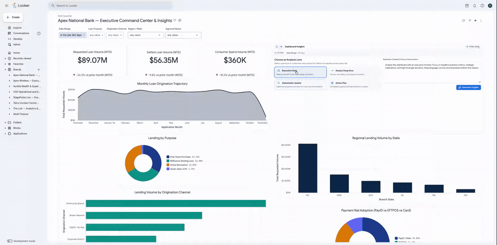
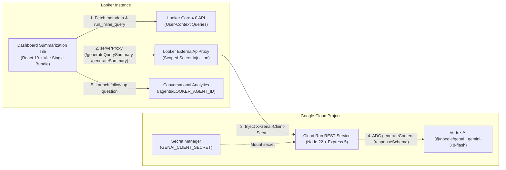

# Looker Dashboard Summarization

A Looker Extension Framework dashboard tile that synthesizes live dashboard queries into structured executive briefs, tile-by-tile analytical breakdowns, and Looker Conversational Analytics follow-up prompts using Gemini on Vertex AI.



## Capabilities

1. **Structured Executive Synthesis**: Runs every tile query under the active viewer's Looker permissions and dashboard filters, summarizes each tile in parallel, and synthesizes an executive brief with impact-tagged key findings and optional prioritized next steps.
2. **Edit-Mode Tile Configuration & Auto-Run**: Entering Looker Dashboard Edit mode (`tileHostData.isDashboardEditing`) opens an integrated Tile Configuration Menu backed by Looker's `CustomerArtifactStore` (`artifact` / `update_artifacts`), allowing authors to configure Auto-Run on load, default persona/prompt instructions, viewer prompt refinement, and section visibility (`Recommended Next Steps` and `Suggested Follow-Up Questions`) for all viewers.
3. **Space-Filling Fluid UI & Collaboration Exports**: Uses a slim single-line header (`title_hidden: true` compatible) and `@container` responsive wide-screen grids, alongside Looker Conversational Analytics follow-up prompts (`/agents/<LOOKER_AGENT_ID>`), one-click Markdown copy, Google Chat OAuth export, and Slack Block Kit OAuth export.

## Architecture



### Technology Stack

- **Frontend**: React 19, TypeScript 5.8, Vite 6 (single classic IIFE bundle with inlined CSS), `react-markdown` + `remark-gfm` + `rehype-sanitize`, `lucide-react`
- **Looker Integration**: `@looker/extension-sdk` (`26.22.0`), `@looker/sdk` (`26.22.0`)
- **Backend Service**: Node.js 22+, Express 5, `@google/genai` (`vertexai: true`), defaulting to `gemini-3.8-flash` (`GOOGLE_CLOUD_LOCATION=global`)
- **Infrastructure**: Cloud Run v2, Secret Manager, least-privilege IAM (`roles/aiplatform.user` + `roles/secretmanager.secretAccessor`) provisioned via Terraform

---

## 1. Cloud Run Vertex AI Service Setup

### Local Development

1. Navigate to the backend service directory and install dependencies:

   ```bash
   cd restful-service/src
   npm install
   ```

2. Authenticate Google Cloud Application Default Credentials:

   ```bash
   gcloud auth application-default login
   ```

3. Export required environment variables and start the server (listens on `http://127.0.0.1:5000` by default):

   ```bash
   export GOOGLE_CLOUD_PROJECT="<PROJECT_ID>"
   export GOOGLE_CLOUD_LOCATION="global"
   export MODEL_ID="gemini-3.8-flash"
   export GENAI_CLIENT_SECRET="<SHARED_SECRET>"
   npm start
   ```

4. Run backend unit tests:

   ```bash
   npm test
   ```

### Cloud Run Deployment (Artifact Registry + Terraform)

1. Create an Artifact Registry Docker repository in your target region:

   ```bash
   gcloud artifacts repositories create dashboard-summarization-docker-repo \
     --repository-format=docker \
     --location="<REGION>" \
     --project="<PROJECT_ID>"
   ```

2. Build and push the container image from `restful-service/src`:

   ```bash
   cd restful-service/src
   gcloud builds submit \
     --project="<PROJECT_ID>" \
     --region="<REGION>" \
     --config="../../src/assets/cloudbuild.yaml" \
     --substitutions="_REGION=<REGION>"
   ```

3. Deploy the Cloud Run service, service account, and Secret Manager secret with Terraform:

   ```bash
   cd ../terraform
   terraform init
   terraform apply \
     -var="project_id=<PROJECT_ID>" \
     -var="deployment_region=<REGION>" \
     -var="vertex_location=global" \
     -var="model_id=gemini-3.8-flash" \
     -var="docker_image=<REGION>-docker.pkg.dev/<PROJECT_ID>/dashboard-summarization-docker-repo/dashboard-summarization-service:latest" \
     -var="genai_client_secret_value=<SHARED_SECRET>"
   ```

4. Record the `url` output returned by Terraform for configuring `.env` and `manifest.lkml`.

> [!IMPORTANT]
> **Looker (Google Cloud core) Custom Domain Requirement**: Looker Core tenant VPCs configure an authoritative Private Cloud DNS zone for `run.app.` (used internally for Looker services), causing Looker's `ExternalApiProxy` (`extensionSDK.serverProxy`) to return `404 Not Found` for default `*.run.app` URLs. Map a **custom public domain** to the Cloud Run service (for example via Cloud Run Domain Mappings pointing a `CNAME` to `ghs.googlehosted.com.`, or an External Application Load Balancer) and use that custom `https://...` domain in `RESTFUL_WEBSERVICE`, `manifest.lkml` (`external_api_urls`), and the Looker User Attribute **Domain Allowlist**.

### Optional: Cloud Logging Sink for Token Usage Monitoring

Each Vertex AI call writes a structured Cloud Logging entry (`component: "dashboard-summarization-logs"`) including `model` and `usageMetadata` token counts (`promptTokenCount`, `candidatesTokenCount`, `totalTokenCount`). Filter logs in Cloud Logging or route them to BigQuery with:

```text
resource.type = "cloud_run_revision"
resource.labels.service_name = "dashboard-summarization-service"
jsonPayload.component = "dashboard-summarization-logs"
```

---

## 2. Looker Extension Setup

### Local Development

1. From the repository root, copy `.env.example` to `.env` and populate configuration values:

   ```bash
   cp .env.example .env
   ```

   ```ini
   RESTFUL_WEBSERVICE=http://127.0.0.1:5000
   # Used only in local development; production builds strip this variable and use Looker's scoped secret tag
   GENAI_CLIENT_SECRET=<SHARED_SECRET>

   # Optional: Looker Conversational Analytics Agent ID (deep-links to https://<your-instance>.cloud.looker.com/agents/<AGENT_ID>)
   LOOKER_AGENT_ID=

   # Optional: Google Chat & Slack OAuth client IDs and target destinations
   GOOGLE_CLIENT_ID=
   SPACE_ID=
   SLACK_CLIENT_ID=
   CHANNEL_ID=
   ```

2. Install dependencies and start the HTTPS Vite dev server:

   ```bash
   npm install
   npm run develop
   ```

   - Looker dev bundle endpoint: `https://localhost:3000/dashboard_summarization.js`
   - Standalone local UI preview (outside Looker): `https://localhost:3000/?preview=1`

3. Run typechecking and frontend unit tests:

   ```bash
   npm run typecheck
   npm test
   ```

4. Create a blank LookML project in Looker, add `manifest.lkml`, and include your Cloud Run URL in `external_api_urls`:

   ```lkml
   project_name: "dashboard-summarization-extension"

   application: dashboard-summarization {
     label: "Dashboard Insights Powered by Vertex AI"
     # file: "dashboard_summarization.js"
     url: "https://localhost:3000/dashboard_summarization.js"
     mount_points: {
       dashboard_vis: no
       dashboard_tile: yes
       standalone: no
     }
     entitlements: {
       local_storage: yes
       use_form_submit: yes
       use_clipboard: yes
       new_window: yes
       new_window_external_urls: ["https://*.looker.com/*", "https://slack.com/*"]
       core_api_methods: ["me", "run_inline_query", "run_query", "all_lookml_models", "dashboard", "dashboard_dashboard_elements", "artifact", "update_artifacts"]
       external_api_urls: [
         "https://<YOUR_CLOUD_RUN_SERVICE_URL>",
         "http://127.0.0.1:5000",
         "http://localhost:5000",
         "https://localhost:3000",
         "https://*.googleapis.com",
         "https://slack.com/api/*",
         "https://slack.com/*"
       ]
       oauth2_urls: [
         "https://accounts.google.com/o/oauth2/v2/auth",
         "https://www.googleapis.com/auth/chat.spaces",
         "https://www.googleapis.com/auth/userinfo.profile",
         "https://www.googleapis.com/auth/chat.spaces.readonly",
         "https://www.googleapis.com/auth/chat.bot",
         "https://www.googleapis.com/auth/chat.messages",
         "https://www.googleapis.com/auth/chat.messages.create",
         "https://slack.com/oauth/v2/authorize"
       ]
       scoped_user_attributes: ["genai_client_secret"]
     }
   }
   ```

### Production Bundle Deployment

1. Build the self-contained Looker bundle (with `RESTFUL_WEBSERVICE` set to your deployed Cloud Run URL in `.env`):

   ```bash
   npm run build
   ```

   This produces a single file (`dist/dashboard_summarization.js`) with all styles inlined.

2. Upload `dist/dashboard_summarization.js` to your LookML project, switch `manifest.lkml` from `url:` to `file: "dashboard_summarization.js"`, and deploy to production.
3. Create a hidden Looker User Attribute named `<extension_id>_genai_client_secret` (replacing `-` and `::` in the extension ID with `_`, e.g. `dashboard_summarization_extension_dashboard_summarization_genai_client_secret`), restrict its **Domain Allowlist** to `https://<YOUR_CUSTOM_CLOUD_RUN_DOMAIN>/*`, and set its default value to `<SHARED_SECRET>`. (If updating an existing hidden User Attribute's Domain Allowlist, clear `default_value` to `null` first, update `hidden_value_domain_whitelist`, and then re-apply `default_value`.)

---

## 3. Optional Collaboration Exports

### Slack OAuth Setup

1. Create a [Slack OAuth v2 application](https://api.slack.com/authentication/oauth-v2) with `chat:write` and `channels:read` scopes.
2. Add `SLACK_CLIENT_ID` and `CHANNEL_ID` to the frontend `.env` before building.
3. Configure `SLACK_CLIENT_ID` and `SLACK_CLIENT_SECRET` as environment variables (or Secret Manager references) on the Cloud Run service so `/slack/oauth-exchange` exchanges authorization codes server-side without exposing `SLACK_CLIENT_SECRET` in browser code.

### Google Chat OAuth Setup

1. Configure a Google Cloud OAuth 2.0 Web Client and enable the Google Chat API.
2. Add `GOOGLE_CLIENT_ID` and target `SPACE_ID` to `.env`, and add the Chat app to your target space.

---

## Grounding Recommendations

- **Dashboard Descriptions**: Populate the dashboard's **Details -> Description** field in Looker to give Gemini overarching business context and KPI definitions.
- **Tile Notes**: Add concise notes on individual dashboard tiles to clarify metric nuances, targets, or caveats that Gemini should incorporate into tile and executive summaries.
